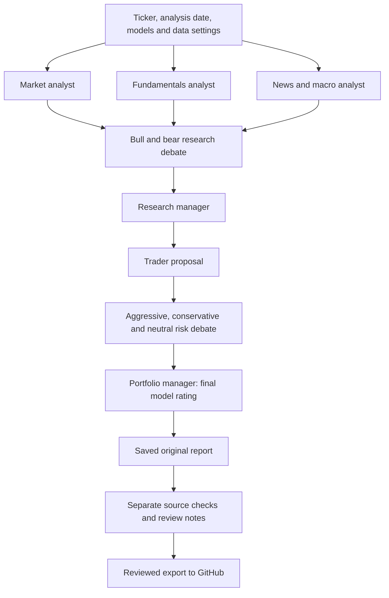

# How these reports are produced

The three selected analysts run in parallel. Each can make repeated tool calls before producing a report. The optional social-sentiment analyst is not enabled for the initial ARM report.

| Stage | Model tier | Main purpose |
|---|---|---|
| Market analyst | Quick | Yahoo Finance prices and technical indicators |
| Fundamentals analyst | Quick | SEC EDGAR/Yahoo Finance financials and company information |
| News analyst | Quick | Company news, FRED macro series and prediction-market context |
| Bull and bear researchers | Quick | Argue competing interpretations of the analyst reports |
| Research manager | Deep | Weigh the debate and form an investment plan |
| Trader | Quick | Translate the plan into a proposed action |
| Risk reviewers | Quick | Challenge risk, sizing and execution assumptions |
| Portfolio manager | Deep | Produce the final model decision and rating |

For the initial published ARM run, **both tiers use DeepSeek V4 Pro via OpenRouter**. There is one research-debate round and one risk-debate round. The 16,384-token cap applies per model response, not to the entire run. Repeated tool calls mean a run can use substantially more tokens.

The model chooses which available tools to call. A configured data source is not proof that every series from that source was used. Source availability and selected report claims are checked separately.

The run has fresh memory and a separate results folder. TradingAgents can retain prior decisions and reflect on them in later runs; isolated run folders prevent earlier drafts from influencing this report. No personal portfolio was supplied, so allocation examples are hypothetical.

The final rating is model output, not a broker order. Our wrapper saves it as JSON and does not connect to a broker. Structured-output failures can trigger upstream free-text fallbacks; those should be recorded in review notes when present.

## Why the review step matters

Debate is not independent fact-checking. All roles can share the same model weaknesses, trust a mistaken analyst report, or confuse stale and current data. FRED adds macroeconomic evidence but does not fix price arithmetic or accounting interpretation.

Our separate review recomputes selected indicators, checks important claims against primary sources, distinguishes intraday prices from final closes, and highlights unresolved discrepancies. Original model sections are preserved rather than silently edited. These checks are selective, not a guarantee that every claim is correct.

The repository contains exported research and review notes. API keys, private runtime traces and full local caches stay outside it. See [README](README.md) for the procedure for adding future reports.
